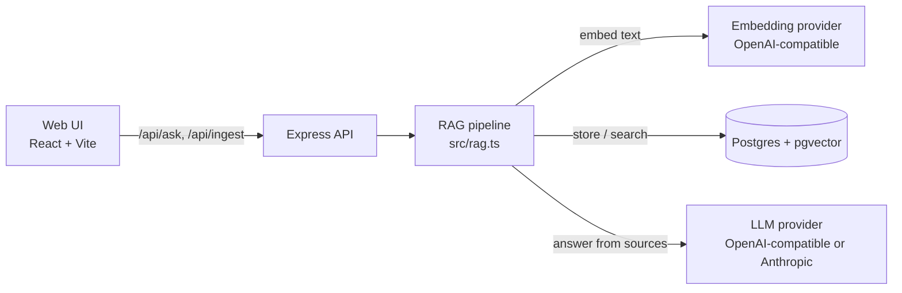
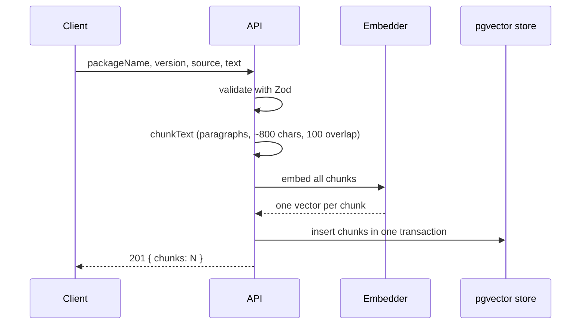
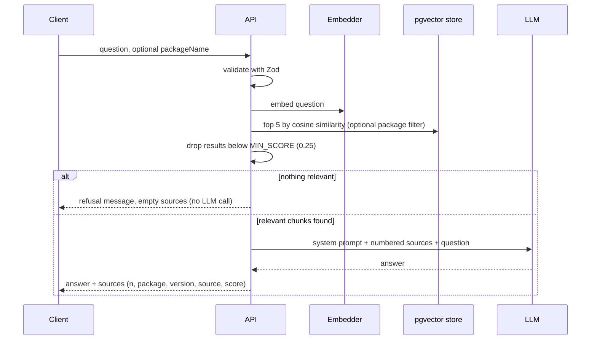

# VerDrift Architecture

VerDrift answers "will upgrading this package break my code?" from ingested release notes. It is a retrieval-augmented generation (RAG) service: release notes are chunked, embedded, and stored in Postgres with pgvector. A question retrieves the most similar chunks, and an LLM answers using only those chunks, with citations. If retrieval is weak, the service refuses instead of guessing.

## Repository layout

```
api/   Express + TypeScript backend (RAG pipeline, REST API, tests)
web/   React + TypeScript + Vite frontend
docs/  Architecture and screenshots
```

## System overview



In development the Vite dev server proxies `/api` and `/health` to the Express server, so the browser sees a single origin and no CORS configuration is needed. A deployed setup would need CORS enabled on the API or a reverse proxy in front.

## Data flows

### Ingestion: `POST /api/ingest`



### Question answering: `POST /api/ask`



## Components

| Component | File | Responsibility |
|---|---|---|
| HTTP layer | `src/app.ts` | Routes, Zod request validation, error handler (400 for validation errors, 500 otherwise) |
| Pipeline | `src/rag.ts` | `ingest()` and `ask()`: the core logic, independent of HTTP and of any provider |
| Chunking | `src/chunk.ts` | Splits on blank lines into ~800-character chunks with 100 characters of overlap; hard-splits oversized paragraphs |
| Vector store | `src/pgStore.ts` | pgvector storage and similarity search (production) |
| Test store | `src/memoryStore.ts` | In-memory cosine search with the same interface (tests) |
| Embedder | `src/embed.ts` | Calls any OpenAI-compatible `/embeddings` endpoint |
| LLM | `src/llm.ts` | OpenAI-compatible chat completions, or the Anthropic Messages API |
| Config | `src/config.ts` | Environment validation with Zod; fails fast on missing values |
| Wiring | `src/wire.ts` | Builds real dependencies from config |
| Ingest CLI | `scripts/ingest.ts` | `npm run ingest -- <package> <version> <file>` |

### Dependency injection

`src/types.ts` defines three interfaces: `VectorStore`, `Embedder`, and `LLM`. The pipeline and the HTTP layer depend only on these interfaces, and `wire.ts` supplies real implementations. Tests supply fakes, so the full pipeline, including HTTP, runs without network access or a database.

## Database

```sql
chunks (
  id           BIGSERIAL PRIMARY KEY,
  package_name TEXT NOT NULL,
  version      TEXT NOT NULL,
  source       TEXT NOT NULL,
  content      TEXT NOT NULL,
  embedding    vector(768) NOT NULL
)
-- HNSW index on embedding using cosine distance, plus an index on package_name
```

Similarity search orders by `embedding <=> query` (cosine distance) and reports `score = 1 - distance`, so higher means more similar. The optional package filter is applied in the same query. Inserts for one ingest call run in a single transaction, so a failure leaves no partial document.

The vector dimension is fixed in the schema. It must equal the output size of the embedding model (768 for `nomic-embed-text`, 1536 for OpenAI `text-embedding-3-small`). Changing the model means recreating the table and re-ingesting.

## Providers and configuration

Embeddings use any OpenAI-compatible endpoint. Answers use either an OpenAI-compatible chat endpoint (`LLM_PROVIDER=openai`, the default) or Anthropic (`LLM_PROVIDER=anthropic`). The defaults target a local Ollama instance (`nomic-embed-text` for embeddings, `llama3.2` for answers), so the project runs with no paid API keys. All settings come from environment variables validated at startup (see `.env.example`).

## Frontend

React with Vite. The page owns a single request state, a discriminated union of `idle`, `loading`, `success`, and `error`. A new question aborts the previous in-flight request with `AbortController`, so a slow older response cannot overwrite a newer one. A refusal is a successful response with no sources and is rendered as a notice, not an error. An "Add release notes" panel calls the ingest endpoint.

## Key design decisions

- **Refuse instead of guess.** Results below `MIN_SCORE` never reach the LLM. This is the main defense against invented answers, and it also avoids a paid or slow model call.
- **Cited, source-bound answers.** The system prompt tells the model to answer only from the numbered sources and to cite them. The response always returns the source list, even if a small model omits inline citations.
- **Provider-agnostic design.** Everything external sits behind an interface, which allowed switching from paid APIs to free local models without touching the pipeline.
- **Postgres with pgvector, not a separate vector database.** One datastore handles both metadata filtering and similarity search, and it matches the stack named in the target job description.
- **Schema validation at the edges.** Zod validates both HTTP bodies and environment configuration.

## Testing

Twelve automated tests run with `npm test` in `api/`, with no network or database:
- chunking behavior and size bounds
- retrieval quality, with a known breaking-change chunk that must rank first
- refusal without an LLM call, and package filtering
- HTTP validation (400s) and an end-to-end ingest-then-ask flow
- the OpenAI-compatible embedder and LLM clients, checked against a local mock server

Not covered by automated tests: the real pgvector SQL, real provider responses, and the frontend. These were checked by hand against local Ollama.

## Known limitations

- No authentication, rate limiting, or users yet.
- Ingesting the same document twice creates duplicate chunks (no deduplication).
- Chunking is character-based and paragraph-aware, not token-aware or structure-aware (headings, version sections).
- No timeouts, retries, or batching for provider calls, so very large documents may fail.
- `MIN_SCORE` and chunk size were set by judgment, not tuned. There is no formal evaluation set yet.
- Small local models sometimes omit the inline `[n]` citations that the prompt requests.
- The Docker image and deployment path are untested.

## Planned work

1. Evaluate retrieval on real release notes with a labeled question set, then tune `MIN_SCORE` and chunk size.
2. Deduplicate on ingest and add per-version metadata filters.
3. Authentication and rate limiting.
4. CI running the test suite on every push.
5. Deployment with a hosted Postgres.